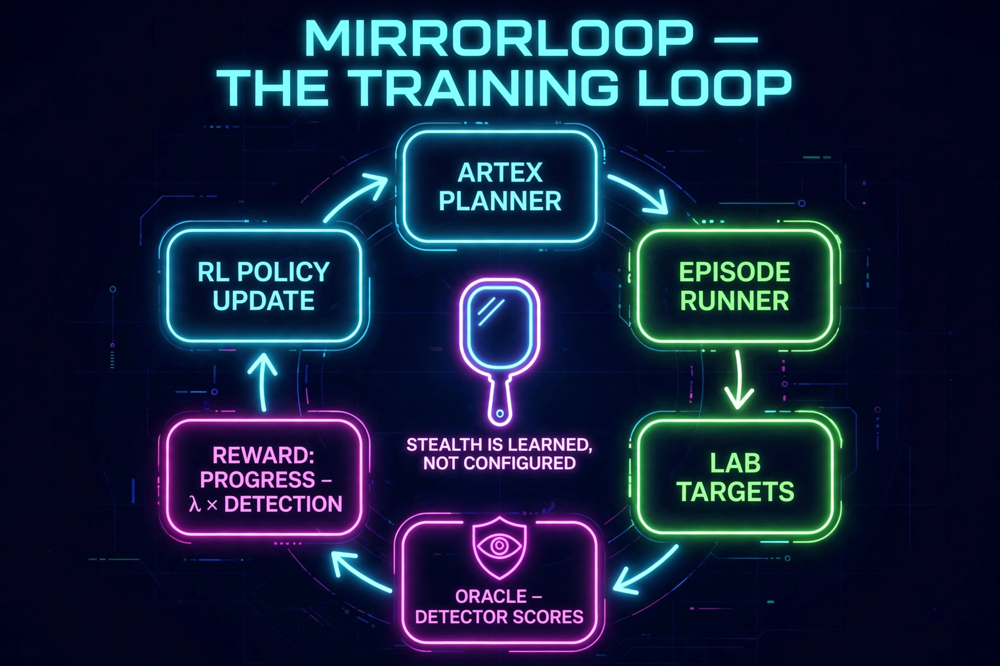
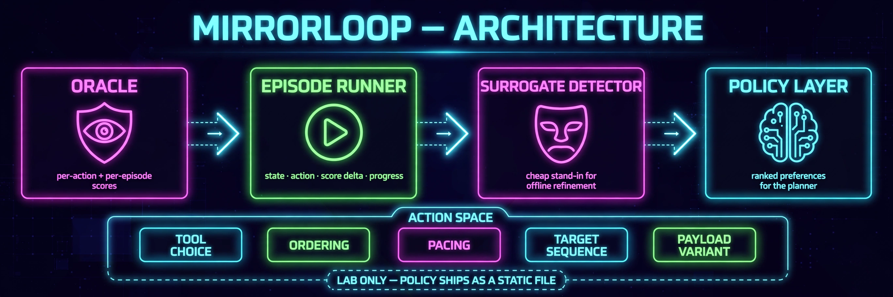

# MIRRORLOOP — Detector-in-the-Loop Planner Training

**Status: concept / proof-of-concept design. No code ships with this document.**
MIRRORLOOP is published as an idea for the community to implement, test, and break.
Gate record: Research & Innovation Engine candidate `mirrorloop-detector-rl-planner` —
**JEV gate PASS, weighted 0.712** (novelty .70 · coherence .80 · feasibility .66 ·
redundancy-safety .72 · evidence .68), 2026-11-27.

> **Scope:** MIRRORLOOP is a *lab* training architecture. The loop only functions
> where engagements can be run repeatedly against instrumented targets with a
> scoring detector — an authorized research range. It is not a field tool, and
> the policy it produces is only as meaningful as the lab that trained it.

---

## The idea in one paragraph

Every stealth technique for an autonomous agent is currently a *ruleset* — a
human operator's guesses about what looks suspicious, frozen into configuration.
MIRRORLOOP replaces the guesses with training. In the lab, the agent runs
engagements against instrumented targets while a **detector scores every action
and every episode**. A reinforcement-learning layer over the planner's action
space — *which tool, in what order, at what rate, against which target first,
with which payload variant* — learns policies that **complete the objective
while minimizing cumulative detection score**. Stealth stops being something
you configure and becomes something the planner *learned from the defender's
own measurements*.

The name is the mechanism: the detector is held up as a mirror, and the planner
trains against its own reflection until the reflection goes quiet.

## Why this is not just "RL for pentesting"

RL has been pointed at security agents before, and at detectors before — but
never, in the checked record, at each other through the *planner*:

| System | Learns | Reward signal | Action space |
|---|---|---|---|
| gym-malware (Anderson et al., 2018) | evasion policy | static ML detector score | mutations of a PE file |
| IDSGAN (Lin et al., 2018) | attack generator + detector model | real IDS, via a learned discriminator | traffic features |
| RL-CyberBench-style agent RL | task policy | objective success | agent actions |
| **MIRRORLOOP** | **planner policy** | **detector score (per action + per episode)** | **engagement action sequences** |

The transplant is the contribution: evasion-RL moved out of *artifact space*
(mutating a file until a scanner shrugs) and into *plan space* (sequencing an
engagement until a detector shrugs), with the detector's score — not task
success — as the optimized objective. A surrogate detector model, trained
IDSGAN-style alongside the real oracle, lets the policy refine cheaply offline
and only periodically validate against the real stack.

## Architecture

**1. ORACLE — the scoring detector.**
A lab detector stack (an IDS/NDR, or a defensive agent such as Ghost Reaper)
exposing **per-action and per-episode detection scores** through an API.
Attribution matters: an episode total alone is too sparse to learn from; the
oracle must be able to say *which action lit it up*.

**2. EPISODE RUNNER — the range harness.**
Executes engagements against instrumented targets and logs the full training
record: `(state, action, score delta, objective progress)`. Every episode is a
real run — there is no simulator shortcut, which is exactly why the loop is
lab-bound.

**3. POLICY LAYER — the learned planner preferences.**
RL over a **discretized** planner action space: tool choice, ordering class,
pacing class, target sequencing, payload variant class. The output is a static
policy artifact — ranked preferences and constraints the LLM planner consults
at plan time. At deployment there is no loop and no learning; the policy is a
file. The LLM planner still bounds the search to sane plans, which is what
makes the sample efficiency survivable.

**4. SURROGATE — the cheap stand-in.**
A discriminator trained to predict oracle scores from action sequences. The
policy trains against the surrogate for volume and against the real oracle for
truth, on a validation cadence. Divergence between surrogate and oracle is
itself a monitored metric — it is the first symptom of overfitting.

## How a training run proceeds

1. **Baseline.** The native planner runs a battery of objectives. Record
   detection-score integrals and completion rates. This is the number to beat.
2. **Surrogate warm-up.** A few hundred scored episodes train the surrogate
   until its score predictions track the oracle within a stated tolerance.
3. **Policy training.** RL episodes alternate surrogate and oracle scoring.
   Reward = objective progress − λ · detection score, with λ swept, not fixed:
   the interesting output is the *frontier* of stealth vs. completion, not a
   single point.
4. **Transfer test (the headline).** The frozen policy is evaluated against a
   **held-out detector stack it never trained against**. The transfer gap —
   how much of the stealth survives an unseen defender — is the metric this
   design exists to produce.
5. **A/B.** Policy-guided vs. native planner, identical objectives, both
   oracles. Report score integrals, completion, and the transfer gap.

## What would kill it (falsifier, stated in advance)

> Policies trained against the lab oracle show **no detection-score reduction
> against a held-out detector stack** (transfer ≈ 0), **or** objective
> completion collapses under the learned policy. Either result kills the
> premise that engagement stealth is *learnable* rather than oracle-specific
> noise — and that negative result is itself a publishable answer about the
> limits of detector-driven training.

## The defensive half (why a defense project publishes this)

MIRRORLOOP is filed inside REVENANT because the loop cuts both ways, and the
defense should be built with the training process in view:

- **Policy search is itself a signal.** An agent optimizing against your
  scores must *explore* — systematic probing of the action space has a shape,
  and that shape is detectable before any single action is.
- **Scoring surfaces can be poisoned.** A detector that knows it is an oracle
  can offer honeypot scores — rewarding the behaviors it most wants to see,
  taxing the ones it can catch best — and turn the attacker's curriculum
  against itself.
- **Transfer is the defender's friend.** A policy overfit to one stack is the
  expected failure mode; detector *diversity* across deployments is a
  structural countermeasure, and the transfer gap is how you measure it.
- gym-malware's own history is the precedent: once the evasion loop existed,
  adversarial retraining against it cut attack success by ~33%. The loop
  matters to whoever runs it second, too.

## Build phases (for whoever picks this up)

- **Phase 0 — oracle plumbing.** Stand up per-action score attribution on one
  detector stack (Ghost Reaper + one open IDS is the reference pairing);
  freeze the discretized action space over the agent's existing tool set.
- **Phase 1 — episodes + surrogate.** Runner, logging schema, surrogate v1;
  measure surrogate–oracle divergence on held-out episodes.
- **Phase 2 — policy + transfer.** RL policy v1, λ-frontier sweep, held-out
  stack transfer test, A/B report. Publish the transfer gap either way.

Implementation notes: the seam on the agent side is the planner's
action-selection hook — anything with an LLM planner and a tool registry has
one. Nothing in this design requires a specific RL algorithm; the discretized
space is small enough that tabular-to-function-approximation is an
implementer's choice. Contributions to REVENANT follow the repository's
AGPL-3.0 terms.

## References

- Anderson, Kharkar, Filar, Evans, Roth — *Learning to Evade Static PE
  Machine Learning Malware Models via Reinforcement Learning* (gym-malware).
  arXiv:1801.08917, 2018.
- Lin, Shi, Xue — *IDSGAN: Generative Adversarial Networks for Attack
  Generation against Intrusion Detection*. arXiv:1809.02077, 2018; PAKDD 2022.

---

*MIRRORLOOP was synthesized by the Research & Innovation Engine (Agent X ×
Meta-Architect, JEV-gated) on 2026-11-27 as part of an ARTEX stealth-layer
survey, and is floated here as an open design: the code can be written by
anyone who reads it. If you build it, the transfer gap is the number the
rest of us want to see.*
