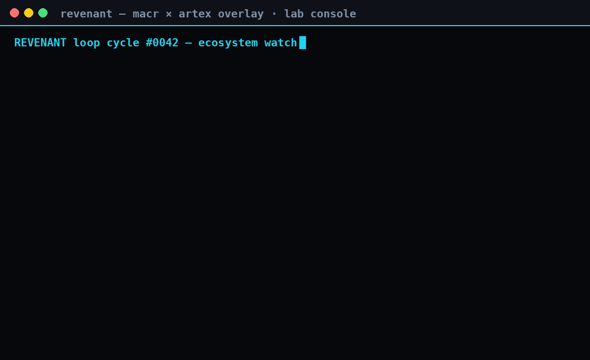
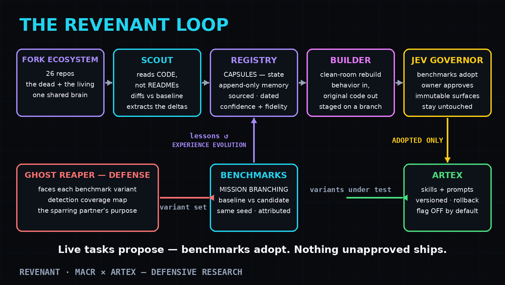
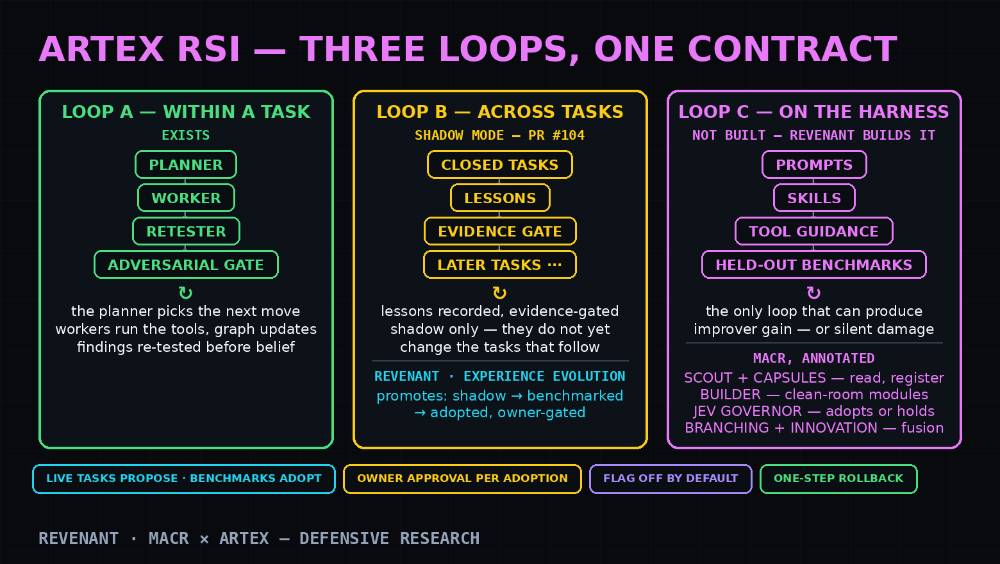

# REVENANT

### The learning layer for ARTEX

*It reads the dead forks. It rebuilds what they knew.*

ARTEX is a formidable autonomous penetration-testing framework — and a frozen one. Every deployment runs the same snapshot while the ecosystem around it mutates: the original Autumn-27 repo was deleted in October 2026, and within weeks more than twenty forks appeared — hardened, rebranded, stripped of guardrails, extended. A static build defends against yesterday's variant.

**REVENANT makes ARTEX learn.** It is a MACR (MUSE Adaptive Cognitive Runtime) overlay that implements the harness-level self-improvement loop — **Loop C** — specified in ARTEX's own [`RSI.md`](RSI.md), which the upstream project defines by contract but has not built. REVENANT adds the one thing the contract never contemplated: learning from *outside* its own tasks, from the whole fork ecosystem.

> Introduced to the upstream maintainer here: [BaaRai/ARTEX#486](https://github.com/BaaRai/ARTEX/issues/486)

## How it works

- **Scout** reads the fork ecosystem — the code, not the READMEs — and extracts technique deltas against the pinned baseline into a registry. Every entry is behavioral (what it does, in plain language), sourced, dated, and confidence-labeled. **No fork code is copied or executed. Ever.**
- **Registry (Capsules)** is the durable memory: append-only, evidence-backed state that survives builds, model swaps, and redeploys. The capability lives in the memory; the code is the disposable part.
- **Builder** reimplements registry techniques *clean-room* as ARTEX skills, staged for review — never written straight into the active tree.
- **JEV Governor** gates every adoption, mechanically enforcing the RSI contract (below). It proposes nothing and executes nothing; it only decides.
- **Benchmarks (Mission Branching)** run held-out tasks as paired branches — baseline vs candidate, same seed — with regressions attributed to a specific module.
- **Experience Evolution** promotes cross-task lessons out of ARTEX's shadow-mode Loop B through the same gate.

The variants REVENANT produces exist for one purpose: to be faced by defensive systems (it is the sparring-partner engine behind [Ghost Reaper](https://github.com/Insider77Circle/Ghost-Reaper)) so detection coverage is measured against a *current* adversary, not a museum piece.

## The three loops

ARTEX already learns within a task (Loop A) and records lessons across tasks in shadow mode (Loop B). Loop C — improving the harness itself — is where an unguarded system can silently damage itself, which is why upstream left it as a contract. REVENANT implements Loop C *under* that contract:

1. **Live tasks propose; held-out benchmarks adopt.** A live success is never adoption evidence.
2. **Owner approval per adoption** — one explicit, recorded action. No self-approval, no silent state.
3. **Immutable surfaces** — gates, scope and authorization checks, prompt-injection defenses, and tool allowlists are never in the search space.
4. **One-step rollback** — prompt changes are versioned; skills are files under git.
5. **Flag off by default** — the overlay ships disabled; enabling it is an owner decision, checked per run.
6. **Bounded edit budget**, annealed per round.
7. **Attribution** — regressions are pinned to a module, not to "the loop."
8. **Clean-room only** — techniques are learned by reading and reimplemented from understanding.

## Status — honest, by phase

| Phase | What | State |
|---|---|---|
| 0 | Baseline pinned (BaaRai/ARTEX @ 565f448), seams surveyed | ✅ Done |
| 1 | Scout ecosystem pass — 21/21 forks read first-hand | ✅ Done — **96 techniques** registered (63 high confidence). First-hand reading corrected published survey claims (e.g. one fork's widely-reported proxy pool is not in its code) |
| 2 | Governor adoption gate + capsule wiring | ✅ Built — pipeline `candidate → staged → benchmarked → adopted`; adoption refuses without flag + passing benchmark + recorded owner approval; hash-chained decision receipts; 14/14 tests pass; **overlay ships OFF** |
| 3 | Builder clean-room modules (access-persistence first) + held-out benchmark runs | ⏳ Gated — requires the owner's lab and per-batch go-ahead |
| 4 | Loop B lesson promotion path | Planned |
| 5 | Cross-technique fusion proposals through the novelty gate | Planned |

Nothing in this repository runs against anything. Execution happens only in the owner's lab, per batch, on the owner's word.

## Why "REVENANT"

The original ARTEX died — repo deleted — and returned through its forks. REVENANT is that pattern, made deliberate: a system whose persistence comes from being *rebuildable*. Delete its build, swap its model, replace its baseline — the library remains, and the Builder re-derives the capability onto whatever chassis is current.

## Upstream

This is a fork of [BaaRai/ARTEX](https://github.com/BaaRai/ARTEX), the English continuation of Autumn-27/ARTEX, without which none of this exists. For ARTEX itself — install, configuration, usage — see the upstream repository and the documentation in [`docs/`](docs/). Anything here that proves generally useful will be offered upstream as PRs.

## License

AGPL-3.0, inherited from upstream and kept deliberately. If the combined work is distributed, the obligations attach to the whole — that is the price of building on a commons, and it is paid gladly.

## Safety

REVENANT is defensive research infrastructure: its output is adversary *variants for detection testing in a lab*. It inherits ARTEX's scope and authorization checks as immutable surfaces, adds an adoption governor on top, and ships disabled. If you are looking for the variant with the guardrails stripped out, several forks already did that — this is the one studying them.
